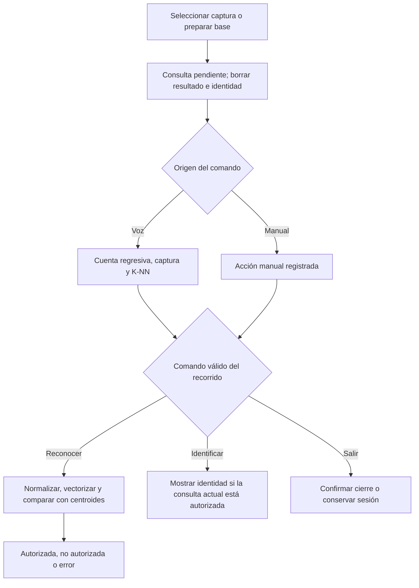

# Cierre de desarrollo · interfaz, integración y ampliación de huellas

**Trabajo Final · Inteligencia Artificial I · Ingeniería en Mecatrónica · UNCUYO · 2026**  
**Fecha:** 23/10/2026, Argentina. **Estado:** versión final de desarrollo entregable para la muestra. La evaluación final independiente y las pruebas acústicas con personas nuevas siguen pendientes.

## Versión fijada y ejecución

El modelo principal para la muestra es **20261023T222326_850333Z**, combinado: 36 de 144 características GLCM seleccionadas, escalado guardado, K-means con tres grupos, correspondencia grupo–identidad y distancia euclidiana con umbral **4.136012624996962**. PCA no interviene en inferencia. Audio conserva **20261023T033845_362145Z**, 160 características estandarizadas y K-NN k=1 con voto uniforme. No se identifica al hablante.

Desde la raíz, con el entorno Windows existente y los modelos disponibles:

```powershell
.\.venv\Scripts\python.exe src/interfaz.py --config config/interfaz_anguli_experimental_v1.json
```

El nombre experimental se conserva como identificador de la ampliación, no implica que haya que volver a ajustar el modelo antes de la muestra. La configuración predeterminada `config/interfaz_v1.json` sigue apuntando al modelo anterior de 72 columnas. Se conserva como respaldo, junto con sus parámetros y métricas históricos. Para abrirlo:

```powershell
.\.venv\Scripts\python.exe src/interfaz.py
```

No se modificó el código de ventana/audio, el extractor ni la normalización al fijar esta versión. No se movieron archivos o carpetas. La reorganización será una tarea posterior. El ZIP de cierre documental requiere las entregas de interfaz, preparador y modelo combinado ya instaladas; no vuelve a incluir datasets o modelos.

Para una instalación Windows que aún necesite dependencias, Tkinter debe estar incluido en la instalación de Python; desde PowerShell:

```powershell
.\.venv\Scripts\python.exe -m pip install --only-binary=:all: -r requirements-interfaz.txt
.\.venv\Scripts\python.exe -m pip check
.\.venv\Scripts\python.exe src/interfaz_servicios.py --config config/interfaz_anguli_experimental_v1.json
```

El registro del autor usa Python 3.14.0. El modelo de audio y sus archivos de extracción son recursos locales ya disponibles en su instalación, no se simulan si faltan. Consultar [recursos de la interfaz](interfaz_integracion.md). La bitácora nueva [08_interfaz_integracion_ampliacion_anguli.ipynb](../notebooks/08_interfaz_integracion_ampliacion_anguli.ipynb) es de solo lectura: no se necesita ejecutarla para utilizar el sistema.

## Qué se entrega

Una ventana única en español con selección/vista previa proporcional, resultado de autorización, identidad condicionada, cuenta regresiva, captura de audio sin escucha permanente, selección de micrófono, controles manuales inicialmente plegados y detalles técnicos. Las tareas lentas se ejecutan fuera del hilo Tk y sus respuestas se aplican mediante cola y tokens de operación. El preparador genera automáticamente una captura al seleccionar una base; sus parámetros pueden fijarse en Opciones avanzadas para reproducir un intento. Guardar consulta es explícito y opcional.

Las dos fuentes de captura utilizan el mismo reconocedor combinado. La fuente y la identidad conocida se usan para evaluar el desarrollo, nunca como entradas del clasificador. No se decide por carpeta, nombre de archivo o semilla. No se reentrena al reconocer ni se incorporan consultas al dataset.

| Entrada de usuario | Recorrido y alcance |
|---|---|
| Captura de nuestro generador, original sin normalizar | Seleccionar huella → Reconocer → Identificar si autorizada |
| Impresión Anguli de la configuración ensayada | Seleccionar huella directamente; no agregar nuestras deformaciones |
| Base limpia Fingerprints | Preparar captura → Usar esta captura → Reconocer |
| Otra configuración de Anguli o huella real | No validada; no se garantiza aceptación/identificación correcta |

## Flujo y estados



En la rama de voz se conserva el control de audio inválido. Un audio válido fuera del vocabulario puede ser clasificado como Reconocer, Identificar o Salir: no hay detector de palabras desconocidas ni cuarta clase. La voz requiere pulsar Hablar; las indicaciones son visuales. El silencio inválido no se convierte en una acción.

| Estado de huella | Significado |
|---|---|
| Sin imagen | Reconocer requiere seleccionar una consulta |
| Pendiente | Imagen actual sin decisión vigente |
| Autorizada | Evaluación completada y distancia ≤ umbral |
| No autorizada | Evaluación completada y distancia > umbral |
| Error | No se pudo leer/procesar; no es rechazo biométrico |

Grabación/procesamiento se gestionan por separado. Seleccionar otra consulta elimina autorización e identidad; cancelar un selector conserva el estado. Identificar solo muestra la identidad después de autorización válida y solicitud explícita. Una nueva evaluación fallida no conserva una autorización anterior como si fuera válida. Se bloquean operaciones incompatibles y resultados tardíos de una consulta o sesión anterior. Voz y manual ejecutan las mismas acciones; el origen manual no cuenta como acierto de voz. El control manual permanece disponible si falla el audio y huellas está disponible. Salir por voz/manual/cierre de ventana pide confirmación; cancelar conserva la sesión y cerrar invalida operaciones y libera recursos.

## Ajuste y separación de datos

Se mantuvieron las 220 capturas originales y sus particiones. De ellas se usaron exclusivamente 120 autorizadas de entrenamiento y 50 consultas de validación. Se incorporaron 150 impresiones Anguli de A01–A03 e I01–I02, con bases idénticas a las originales y sin duplicados exactos. No se leyeron las imágenes de prueba final original o las bases I03/I04.

| Uso de las impresiones Anguli | Cantidad | Intervención |
|---|---:|---|
| A01–A03, impresiones 1–20 | 60 | Selección/escalado/K-means con entrenamiento |
| A01–A03, impresiones 21–25 e I01–I02, 1–25 | 65 | Calibración y diagnóstico de validación |
| Cinco identidades, impresiones 26–30 | 25 | Control después de fijar el modelo; sin reajuste posterior |

Cada captura pesa uno: 120 anteriores y 60 Anguli, sin sobremuestreo. Cinco pliegues internos y variantes prefijadas 144/72/36 eligieron 36 columnas solo con entrenamiento. Las etiquetas se usan para selección y correspondencia; K-means agrupa vectores sin recibir identidades. La calibración conserva el criterio de minimizar (FAR+FRR)/2, con desempate por menor FAR y luego menor umbral. Validación y control no ajustan selección/escalado/centroides. El umbral sí usa validación; sus métricas no son prueba independiente.

## Resultados fijados

| Conjunto | Autorizadas aceptadas con identidad correcta | Intrusas rechazadas |
|---|---:|---:|
| Validación anterior | 29/30 | 20/20 |
| Validación Anguli | 15/15 | 50/50 |
| Control Anguli fijado, Linux | 14/15 | 10/10 |
| Mismo control reproducido, Windows del autor | 14/15 | 10/10 |

Las últimas dos filas representan **las mismas 25 imágenes**, no 50 consultas independientes. Sus decisiones e identidades coinciden y las distancias coinciden a tolerancia 1e-12. No hubo errores de procesamiento en el control. Entre las autorizadas aceptadas no hubo identidad incorrecta. A03/Impression_26 fue rechazada con distancia 6.505319363676789. No se aumentó el umbral ni se descartó la muestra para ocultarlo. En validación anterior persiste un falso rechazo.

No se deben comparar distancias de los modelos anterior y combinado como si compartieran la misma escala: cambiaron selección y escalado. Ni la distancia ni el voto de K-NN con k=1 son probabilidades o porcentajes de confianza.

## Evidencia y responsabilidad de cada verificación

| Evidencia | Procedencia y alcance |
|---|---|
| Pruebas de estados, coordinación y recursos | Linux; 20 pruebas de integración/preparador anteriores; dobles de voz identificados como simulaciones de coordinación |
| Modelo combinado y regresión | Linux; cuatro pruebas nuevas más diez de integración anteriores; 125 decisiones de diagnóstico, ajuste real y control de 25 imágenes |
| Ventana con el combinado | Tk real en escritorio virtual Linux; autorización/identificación Anguli, rechazo intruso y captura preparada; inspección visual sin superposiciones |
| Control Windows del autor | Archivos recibidos originales, corrida 20261023T223300_873346Z; 25 filas sin errores, concordantes con Linux |
| Uso de ventana/preparador y regeneración Anguli | Autor informó funcionamiento correcto en Windows, sin conteo individual completo de todos los intentos |
| Audio de etapas anteriores | Evidencia histórica Windows: 15/15 comandos de voz conocida y ensayo sintético exploratorio separado; no evaluación humana independiente nueva |

Se conservan [evidencia del ajuste](resultados_adaptacion_anguli_v1/modelo/resumen.json), [validación](resultados_adaptacion_anguli_v1/comparacion_validacion.csv), [control Linux](resultados_adaptacion_anguli_v1/control/resumen_control.json) y [control Windows](resultados_adaptacion_anguli_v1/control_windows/README.md). Los registros originales de las etapas previas no se reescribieron. El asistente no ejecutó Windows ni tuvo acceso a la computadora del autor.

## Alcance del cierre y pendientes

Se cierra la implementación y su documentación de desarrollo para la muestra. El modelo combinado queda fijo; para demostrar su uso no se necesita generar muestras adicionales, reajustar K-means ni calibrar otra vez.

Persisten la diversidad limitada de bases, dependencia entre impresiones, un falso rechazo del control, ausencia de evaluación con huellas reales y falta de validación de otras configuraciones de Anguli. Las impresiones ensayadas tenían rotación/traslación/ruido/rayaduras en cero; eso no significa que sean copias sin variación de la base. Mantener la semilla no garantiza identidad de salida si cambia el ejecutable o la configuración.

Quedan pendientes:

- Evaluación final reservada con un protocolo fijado antes de ejecutarla; informar identificación y rechazo por separado, sin reajustar con sus resultados.
- Pruebas acústicas con personas nuevas y registro del comando realmente intentado; no inferir aciertos a partir del comando predicho.
- Informe/presentación final y reorganización posterior, conservando rutas o actualizando sus referencias de forma verificada.

La prueba final original contiene capturas de nuestro generador; por sí sola no validará nuevas configuraciones de Anguli. El control adicional no incluye nuevos dedos intrusos. Si se ajusta el modelo después de conocer resultados finales, esos datos pasan a ser desarrollo y se requiere otra evaluación independiente. Ninguna de estas tareas se ejecutó durante este cierre.

## Comprobación breve y commits del cierre

El ZIP de cierre contiene documentación y bitácora; no requiere reinstalar dependencias o repetir entrenamiento. Para revisar recursos y la muestra usar los comandos iniciales. La bitácora 08 puede consultarse con sus salidas guardadas o ejecutarse desde la raíz/notebooks en VS Code con el kernel de .venv. Solo lee archivos publicados; no necesita los originales del experimento ni el modelo local de voz.

Propuesta de commits, después de registrar por separado las entregas anteriores si todavía están pendientes:

```powershell
git status --short
git add documentos/resultados_adaptacion_anguli_v1/control_windows/
git commit -m "Registrar reproduccion del control combinado en Windows"
git add README.md documentos/README.md documentos/cierre_etapa08.md documentos/interfaz_integracion.md documentos/preparacion_capturas.md documentos/experimento_anguli_impresiones_v1.md documentos/modelo_combinado_anguli_v1.md documentos/uso_ia_generativa.md
git commit -m "Cerrar documentacion de interfaz y fijar modelo de desarrollo para la muestra"
git add notebooks/08_interfaz_integracion_ampliacion_anguli.ipynb
git commit -m "Agregar bitacora de interfaz y ampliacion de huellas con evidencia verificable"
```

Revisar git diff --cached --stat antes de cada commit. No usar git add .; no agregar experimentos/, consultas/, entornos o ZIP de entrega. No se hizo push automático.
