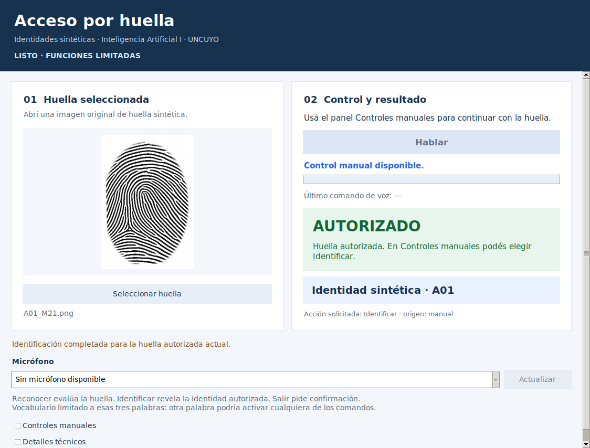

# Verificación de interfaz e integración · 23/10/2026

Se revisó el repositorio público en el commit `26b1a1b`. Los resultados siguientes corresponden a la implementación entregada en esta etapa, no a una ejecución en la computadora del autor.

## Entornos y alcance

- Contratos e inferencia: Linux, Python 3.12.14; NumPy 2.3.5, SciPy 1.17.0, Pillow 12.3.0, matplotlib 3.10.8 y scikit-learn 1.8.0.
- Ventana nativa: escritorio virtual Xvfb de 1440 × 1000, Python 3.12.3 y Tk 8.6.14, con las mismas bibliotecas científicas. Se inspeccionaron las capturas de la aplicación, el apilado al reducir el ancho y el diálogo de confirmación. La tipografía sustituta de Linux no valida Segoe UI ni el escalado de Windows.
- Captura: se instalaron las versiones existentes de sounddevice/cffi/pycparser, pero el entorno no dispone de la biblioteca PortAudio ni de un micrófono utilizable. La aplicación conserva las huellas manuales e informa esa ausencia.
- Audio: el modelo `20261023T033845_362145Z` y el manifiesto/configuraciones de su extracción no se distribuyen en el repositorio. No se cargó ese modelo aquí, no se entrenó un reemplazo ni se midieron aciertos de voz. El adaptador llama al cargador y a `interpretar` existentes cuando esos recursos estén disponibles.

El paquete congelado de huellas publicado sí se cargó realmente. No se modificaron los modelos de desarrollo, datasets, exclusiones o particiones. Las pruebas de regresión existentes pueden construir modelos temporales de control con sus propias entradas, sin cambiar los modelos guardados del proyecto. No se leyó ninguna imagen ni audio de prueba reservada para estas verificaciones.

## Resultados de software

| Grupo | Pruebas aprobadas | Evidencia |
|---|---:|---|
| Contratos nuevos de integración | 10 | [Salida](integracion_linux.txt) |
| Recorridos de ventana | 2 | [Salida](ventana_linux.txt) |
| Regresión K-NN/probador de audio existente | 6 | [Salida](regresion_audio_linux.txt) |
| Regresión de rechazo de huellas existente | 5 | [Salida](regresion_rechazo_linux.txt) |
| **Total** | **23** | Sin fallos en los grupos ejecutados |

Además se verificó la compilación de los archivos Python modificados/nuevos, `git diff --check`, instalación de `requirements-interfaz.txt` y `pip check` (sin dependencias rotas). No se presenta como una ejecución de toda la batería histórica ni como una medición de precisión del sistema completo.

## Concordancia real de huellas

El adaptador abrió originales de desarrollo, aplicó la normalización vigente y extrajo GLCM en memoria. Se comparó con las llamadas directas a las funciones anteriores y con `decisiones_validacion.csv` publicado. Las distancias coinciden a diez decimales y la decisión coincide en todos estos controles. Las diferencias residuales de punto flotante no cambian la aceptación.

| Muestra de desarrollo | Distancia publicada aproximada | Decisión reproducida |
|---|---:|---|
| A01_M21 | 2.880223104365 | Autorizada; identidad A01 al solicitar Identificar |
| A02_M21 | 3.271745691214 | Autorizada |
| A03_M21 | 2.911715244451 | Autorizada |
| I01_M01 | 20.867006203295 | No autorizada; identidad vacía |
| A02_M22 | 10.769863514563 | No autorizada; falso rechazo ya documentado |

No se ajustó el umbral a partir de estas consultas. El caso A02_M22 conserva la limitación previa. Renombrar una imagen fuera del repositorio no cambió su resultado; su contenido sí determina la inferencia. Se comprobó que los originales consultados conservaron sus hashes.

## Cobertura de los requisitos de integración

| Requisito | Comprobación ejecutada | Límite o pendiente |
|---|---|---|
| Inicio y carga | Huellas reales y ventana iniciadas | K-NN exacto ausente |
| Recursos ausentes | Rutas ausentes controladas y errores independientes | Restaurar recursos de voz en Windows |
| Selección y vista previa | Lectura real y miniatura desde la copia completa | El selector se sustituyó por una ruta controlada en el test gráfico; probar diálogo nativo en Windows |
| Cancelar selección | Retorno vacío controlado; estado idéntico | Probar interacción real con selector |
| Nueva imagen | Resultado e identidad borrados | Verificado también en ventana |
| Reconocer sin imagen | Instrucción; no hay inferencia | Verificado |
| Identificar antes de reconocer | Precondición y mensaje | Verificado |
| Identificar tras autorizar | A01 revelada solo después de la acción | Modelo real de huellas |
| Identificar tras rechazar | No se revela identidad | Modelo real, intruso de desarrollo |
| Error de imagen | Imagen blanca produce error; archivo ilegible en ventana | No se etiqueta como rechazo |
| Manual sin micrófono | Ventana operativa con huellas y audio no disponible | Desconexión de un dispositivo real pendiente |
| Captura inválida | Silencio con preprocesamiento real sin consultar K-NN; entrega de evento simulada a Tk | Captura real pendiente |
| Operaciones simultáneas | Tokens, doble solicitud y acciones deshabilitadas | Capturador PortAudio simulado |
| Confirmación/cancelación/cierre | Diálogos reales con los tres orígenes; sesión conservada; cierre con trabajador que observa cancelación | Liberación de micrófono físico pendiente |
| Concordancia con módulos anteriores | Cinco controles reales de huellas; pruebas existentes de formato PCM16 de audio | Misma entrada de voz con modelo exacto pendiente |

Las simulaciones están identificadas en los tests. Los resultados `SIMULADA/SIMULADO` pertenecen únicamente a pruebas de coordinación y negociación de formato. No hay una modalidad simulada oculta en la aplicación. La segunda prueba gráfica devuelve una predicción de Salir y una captura inválida mediante un doble explícito; verifica despacho y confirmación, sin afirmar reconocimiento acústico.

Durante la revisión se corrigió la cancelación de callbacks de Tk al destruir la ventana. Las dos pruebas gráficas finales terminaron sin mensajes de callbacks inválidos.

## Inspección visual

Esta captura muestra una consulta real de huella e identificación solicitada manualmente. La voz está deshabilitada porque falta su recurso; no corresponde a una predicción de audio.

Se revisaron paneles a ancho normal y apilados a 720 píxeles, textos de estado y diálogo de salida. El desplazamiento vertical permite acceder a los controles y detalles. La verificación final de tamaño, fuente y escalado corresponde a Windows.

## Pendientes para cerrar la etapa experimental

Ejecutar la guía corta de `documentos/guias/interfaz_integracion.md` en Windows: carga de ambos modelos, selector nativo, escalado habitual, captura/fin visual, silencio, los tres comandos, bloqueo de repetición y salida/liberación de micrófono. Compartir las salidas y capturas indicadas allí. Conservar la distinción entre demostración con voz conocida, validación con personas nuevas y prueba final independiente.
