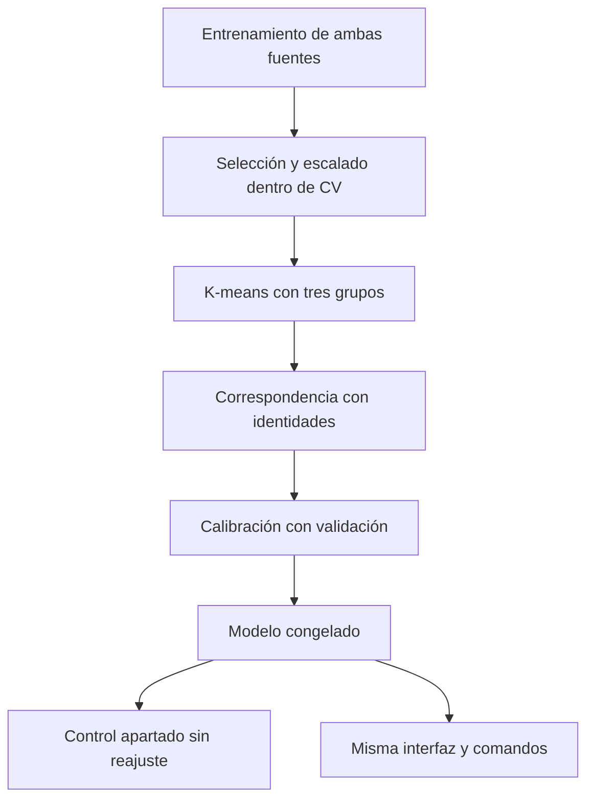

# Modelo combinado de huellas · versión experimental 1

> **Cierre actualizado · 23/10/2026:** El autor comprobó el paquete en Windows y reprodujo las 25 consultas del control con decisiones y distancias coincidentes. También informó reconocimiento en la ventana de impresiones regeneradas con la misma configuración. Este modelo queda fijado como versión final de desarrollo para la muestra. El nombre de archivo experimental se conserva. El alcance final y los pendientes están en cierre_etapa08.md. Véase [cierre de la etapa 08](../etapas/cierre_etapa08.md).

Fecha: 23/10/2026. Se entrega un modelo ajustado y ejecutable con la ventana existente. Conserva el modelo de acceso anterior y el reconocimiento de voz. El lanzamiento normal usa el combinado mediante la configuración principal; el modelo anterior se elige con config/aplicacion_respaldo.json.

## Instalación y prueba en Windows

Cerrar la aplicación y extraer `ia1_modelo_combinado_anguli_v1.zip` sobre la raíz del repositorio con las entregas anteriores instaladas. El ZIP solo agrega archivos, incluidos los parámetros pequeños del modelo experimental. No incluye datasets, grabaciones, entornos virtuales o modelos de audio; conserva sus rutas locales. No es necesario instalar dependencias, reextraer características o entrenar para probarlo.

Desde la raíz del proyecto, ejecutar en PowerShell:

```powershell
.\.venv\Scripts\python.exe -m unittest discover -s tests -p "test_modelo_anguli.py" -v
.\.venv\Scripts\python.exe src/interfaz_servicios.py --config config/interfaz_anguli_experimental_v1.json
.\.venv\Scripts\python.exe src/interfaz.py --config config/interfaz_anguli_experimental_v1.json
```

Se esperan cuatro pruebas aprobadas. El diagnóstico de servicios debe indicar Huellas disponible con modelo **20261023T222326_850333Z**. En Detalles técnicos de la ventana se deben ver **36/144 columnas · sin PCA**. El modelo de voz sigue siendo 20261023T033845_362145Z. Si falta un recurso local de audio, restaurarlo siguiendo la guía anterior: no se reentrena ni se sustituye por simulación.

Para volver al modelo anterior basta cerrar y ejecutar:

```powershell
.\.venv\Scripts\python.exe src/interfaz.py
```

No hay que editar config/interfaz_v1.json ni copiar el nuevo modelo encima del anterior.

### Prueba breve de la ventana

1. Abrir directamente con **Seleccionar huella** la impresión `experimentos/anguli_impresiones_v1/originales/A01_autorizada_semilla101/Impression_21/fp_1/1.png`. Reconocer debe autorizar e Identificar debe revelar A01. No pasar las impresiones por Preparar captura.
2. Probar de la misma forma Impression_21 de A02 y A03. Se espera autorización e identidad correspondiente. Probar Impression_21 de I01 e I02: se espera rechazo y ninguna identidad visible.
3. Abrir Preparar captura con la base A01 original. En Opciones avanzadas activar parámetros manuales, perfil Deformación leve y semilla 2026102301; generar, usar, reconocer e identificar. Se espera A01. El recorrido de generación automática también conserva el mismo funcionamiento, sin garantía para toda combinación aleatoria.
4. Probar Reconocer/Identificar/Salir por voz y manual; las acciones siguen compartiendo lógica y confirmación de salida. No se ha validado micrófono real en el entorno del asistente para esta entrega.
5. Conservar el fallo conocido A03/Impression_26: se rechaza con distancia 6.505319363677, mayor al umbral 4.136012624997. No elevar el umbral ni regenerar para ocultarlo.

Compartir una captura con modelo/36 características en Detalles técnicos, una autorización e identificación de Anguli, un rechazo intruso y cualquier diferencia. No hace falta reenviar las imágenes o el modelo de voz.

### Reproducir el control apartado

El modelo se fijó antes de consultar Impression_26–30. Ya se realizó este control en Linux una sola vez, sin reajuste posterior. El autor ya lo reprodujo en Windows; repetirlo es una comprobación de reproducibilidad, no un nuevo ensayo independiente:

```powershell
.\.venv\Scripts\python.exe src/probar_modelo_anguli.py --control
```

Se esperan 5/5 aceptadas e identificadas de A01, 5/5 de A02, 4/5 de A03 y 0/5 aceptadas de cada intrusa. Sin errores. El programa verifica el lote contra el manifiesto congelado, usa el mismo adaptador de inferencia de la interfaz y genera una carpeta nueva bajo `experimentos/anguli_impresiones_v1/control_modelo_combinado/FECHAUTC`. No entrena ni modifica el modelo. Compartir resumen_control.json y consultas_control.csv si difiere. Se admite --originales para indicar otra carpeta y --config para otro paquete compatible.

## Qué se ajustó y con qué datos

Los cuatro archivos recibidos del diagnóstico Windows fueron comprobados: la matriz (125,144) coincide exactamente con la calculada en Linux, con nombres y referencias en el mismo orden. Las imágenes anteriores se revectorizaron en memoria desde los originales publicados; sus 50 distancias de validación reproducen la evidencia del modelo anterior a tolerancia 1e-9. No se escribieron imágenes ni se regeneraron datasets.

| Uso | Capturas anteriores | Impresiones Anguli | Total |
|---|---:|---:|---:|
| Entrenamiento, solo A01–A03 | 120 | 60 (1–20) | 180 |
| Validación autorizadas | 30 | 15 (21–25) | 45 |
| Validación intrusas I01–I02 | 20 | 50 (1–25) | 70 |
| Control posterior al ajuste | Sin abrir prueba original | 25 (26–30) | 25 |

Cada captura de entrenamiento pesa uno: la fuente anterior representa 2/3 y Anguli 1/3. No se duplicaron muestras para equilibrar. Esta ponderación deriva de conservar el entrenamiento anterior y agregar el lote acordado; no fue optimizada consultando control. En la calibración se conserva el criterio de error balanceado entre autorizadas e intrusas; dentro de cada grupo, las fuentes aportan según su cantidad de muestras. Los resultados se informan también por fuente.

Se reutilizan elegir_con_cv/ajustar de mejorar_clusterizacion_huellas.py, el extractor y la normalización existentes, y medir_distancias/elegir_umbral/decidir_acceso de calibrar_rechazo_huellas.py. Se comparan las variantes prefijadas 144, 72 y 36 características con cinco pliegues de entrenamiento. Cada pliegue vuelve a seleccionar, escalar y ajustar K-means. El criterio previo es mayor ARI medio, empate conservar más columnas. Se eligieron 36 (ARI medio 1), frente a 0.812929 con 72 y 0.293077 con 144.

La selección utiliza etiquetas únicamente de entrenamiento para ordenar características. K-means recibe vectores sin etiquetas, k=3, semilla 20261022 y los mismos parámetros anteriores. La correspondencia grupo–identidad se determina solo con entrenamiento. Se conserva el extractor de 144 componentes como contrato de entrada y se seleccionan las 36 en su orden original. Los intrusos solo intervienen en calibración/rechazo. PCA no interviene. El escalado y los centroides se congelan y el umbral global se calibra solo con validación.



## Resultados y límites

Modelo experimental 20261023T222326_850333Z, 36/144 características, umbral **4.136012624996962**.

| Conjunto | Autorizadas aceptadas con identidad correcta | Intrusas rechazadas |
|---|---:|---:|
| Validación anterior | 29/30 | 20/20 |
| Validación Anguli | 15/15 | 50/50 |
| Control Anguli 26–30 | 14/15 | 10/10 |

No hubo identidades incorrectas entre las autorizadas aceptadas. En validación anterior se conserva el número de aciertos/rechazos del modelo previo; las distancias cambian porque cambió el espacio seleccionado y su escalado. La validación calibra el umbral y no es evaluación independiente. El control Anguli se consultó después de fijar parámetros y no se utilizó para cambiarlos. El campo control_evaluado=false en modelo/resumen.json describe el momento del ajuste; la evaluación posterior se conserva por separado en control/resumen_control.json.

El fallo del control es A03/Impression_26 (distancia 6.505319363677). Se informa como falso rechazo, no error de procesamiento. En validación anterior persiste un falso rechazo. Esto no demuestra tolerancia universal a otras semillas, configuraciones de ruido, ángulos o impresiones. El lote de Anguli tiene rotación/traslación/ruido/rayaduras configurados en cero. Las muestras comparten cinco bases conocidas y sus corridas; el control no estima reconocimiento de nuevas personas ni huellas reales. No se leyó la prueba final original ni las bases intrusas I03/I04.

La entrada admitida experimentalmente es captura de nuestro generador o impresión del procedimiento Anguli ensayado. Las bases limpias siguen pasando por Preparar captura; no se garantiza reconocimiento directo de ellas. No se detecta automáticamente el tipo de fuente ni se utiliza el nombre/carpeta/semilla como dato de inferencia. El clasificador solo recibe características de imagen. Las consultas no se incorporan al entrenamiento.

## Verificación de software

Se cargó el paquete mediante el adaptador real de la aplicación y se verificó integridad de parámetros, configuración de audio idéntica, entrenamiento sin intrusos/control y reconocimiento de imágenes anteriores. Cuatro pruebas nuevas y diez pruebas de integración anteriores aprobaron. Se ejecutó la ventana Tk real en escritorio virtual Linux con la configuración alternativa: impresión Anguli autorizada e identificada, intrusa rechazada con limpieza de identidad y captura preparada autorizada. No hubo errores Tk; se inspeccionó la vista y no se observaron superposiciones. La ausencia de micrófono/modelo local de voz aquí produce funciones limitadas, no una simulación acústica.

El autor reprodujo el control en Windows/Python 3.14 y comunicó funcionamiento de la ventana con ambas fuentes. No se registró una evaluación acústica nueva controlada para este paquete; siguen pendientes personas nuevas y evaluación final. Los parámetros NPZ y JSON no dependen de pickle. El código de la interfaz, servicios, audio y configuración predeterminada no se modificó.

## Reproducir entrenamiento, opcional

El modelo incluido ya está ajustado; no ejecutar para cada uso. Para reproducir se necesitan el dataset original local y los cuatro archivos del diagnóstico de Windows:

```powershell
.\.venv\Scripts\python.exe src/adaptar_modelo_anguli.py --diagnostico "experimentos\anguli_impresiones_v1\diagnosticos\20261023T220542_412748Z"
```

Crea una corrida nueva en experimentos/anguli_impresiones_v1/modelos_combinados, con su propia configuración de interfaz y manifiesto. El programa verifica hashes del dataset anterior, nombres/referencias de vectores, particiones e integridad del modelo previo. No abre ni vectoriza control o prueba final. Para abrir esa reproducción usar --config con la ruta de config_interfaz_experimental.json que imprime. Comparar métricas y parámetros con tolerancias numéricas, no afirmar igualdad byte a byte de archivos con fechas/entornos distintos. Se conserva la semilla, pero el ajuste se ejecutará en Windows con sus bibliotecas numéricas.

## Archivos y commits

Se agregan adaptar_modelo_anguli.py (ajuste reproducible), probar_modelo_anguli.py (control sin fit), test_modelo_anguli.py, configuración alternativa, esta guía y el paquete completo con parámetros/evidencia. No se cambian los documentos históricos para aparentar resultados posteriores. Esta ampliación y documentación se desarrollaron con asistencia de IA; el lote de Anguli fue generado por el autor y la inferencia es real.

```powershell
git add src/adaptar_modelo_anguli.py src/probar_modelo_anguli.py tests/test_modelo_anguli.py
git commit -m "Ajustar y comprobar modelo combinado de huellas sin alterar el vigente"
git add config/interfaz_anguli_experimental_v1.json documentos/guias/modelo_combinado_anguli_v1.md documentos/evidencias/08_huellas_combinadas/
git diff --cached --stat
git commit -m "Publicar parametros y evidencia del experimento con impresiones de Anguli"
```

Revisar antes de publicar. No agregar experimentos/ ni los ZIP/datasets. No se realiza push automático.
