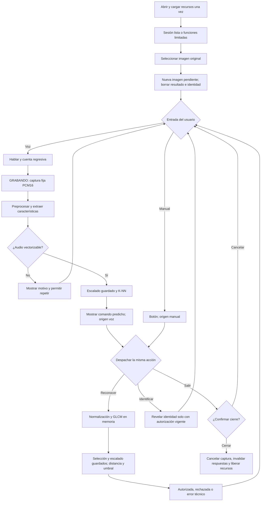

# Interfaz e integración de módulos · etapa 08

> **Cierre actualizado · 23/10/2026:** La interfaz y el preparador fueron probados por el autor en Windows. El modelo combinado es la versión final de desarrollo para la muestra; iniciar con --config config/interfaz_anguli_experimental_v1.json. Esta guía conserva el diseño y las verificaciones de la integración inicial; sus parámetros 72/144 y umbral 5.292172576 pertenecen al respaldo anterior. Véase [cierre de la etapa 08](cierre_etapa08.md).

**Fecha:** 23/10/2026. La primera integración y sus verificaciones se conservan como antecedente. El estado vigente es el cierre indicado arriba; evaluación independiente y pruebas acústicas con personas nuevas siguen pendientes.

## Fuentes y decisiones

Se revisaron la consigna `Trabajo Final 2026.pdf` del material de cátedra (página 4), el repositorio hasta el commit `26b1a1b`, los cierres de las etapas 06 y 07, las configuraciones, los cargadores y las pruebas existentes. La consigna exige K-means con tres grupos para huellas, distancia y umbral, y K-NN para Reconocer, Identificar y Salir. No exige explícitamente una cuarta clase de voz ni rechazo de palabras desconocidas.

La interfaz usa Tkinter/ttk, disponible en la distribución oficial de Python para Windows, y Pillow ya presente. No añade una biblioteca gráfica externa ni cambia versiones. Se eligió una sola ventana, azul, con vista previa proporcional, instrucciones, control principal por voz y dos desplegables: Controles manuales y Detalles técnicos. El contenido tiene desplazamiento vertical y apila sus paneles al reducir el ancho. La fuente prevista en Windows es Segoe UI. Se solicita conocimiento de DPI al sistema antes de construir la ventana.

El entorno registrado por el proyecto es Windows/Python 3.14.0. Las comprobaciones del asistente se hicieron en Linux/Python 3.12.14, conservando NumPy 2.3.5, SciPy 1.17.0, Pillow 12.3.0, matplotlib 3.10.8 y scikit-learn 1.8.0. Se instalaron las dependencias de captura ya especificadas (sounddevice 0.5.3, cffi 2.0.0 y pycparser 2.23); no hubo cambios en esos requisitos. Esto no comprueba un dispositivo ni la instalación de Windows del autor. Para la revisión gráfica adicional se utilizó Python 3.12.3/Tk 8.6 en escritorio virtual; no es un requisito nuevo del programa.

Referencia técnica: [documentación oficial de Tkinter](https://docs.python.org/3.14/library/tkinter.html), en particular el modelo de eventos y de hilos.

## Archivos y reutilización

| Archivo | Responsabilidad |
|---|---|
| `src/interfaz.py` | Ventana, distribución, diálogos, cola de mensajes y trabajador |
| `src/interfaz_estado.py` | Estado de la sesión y precondiciones, independiente de Tk |
| `src/interfaz_servicios.py` | Carga independiente de módulos, comprobación de contratos y adaptadores de inferencia real |
| `config/interfaz_v1.json` | Rutas explícitas de recursos, sin elegir automáticamente la última corrida |
| `requirements-interfaz.txt` | Reúne los requisitos existentes de modelos y captura |
| `tests/test_interfaz_integracion.py` | Estados, recursos, concordancia real y captura simulada |
| `tests/test_interfaz_ventana.py` | Recorrido gráfico con huellas reales; coordinación de voz simulada por separado |

Huellas reutiliza `normalizacion_final.normalizar_huella`, `caracteristicas_huellas.extraer_huella` y `calibrar_rechazo_huellas.cargar_sistema/decidir_acceso`. El modelo publicado conserva 72 de 144 columnas, medias, escalas, tres centroides, correspondencia grupo-identidad y umbral 5.292172575840761. Esos números se leen de los archivos: no se fijan en el comparador. Se verifica el orden completo de nombres antes de aplicar los índices guardados. No interviene PCA.

El cargador de huellas verifica los hashes del modelo/umbral/correspondencia, el vínculo entre los parámetros seleccionados y congelados, la configuración efectiva del descriptor registrada en la selección, el código y configuración de normalización y sus versiones. `interfaz_v1.json` fija además el hash del extractor revisado para esta integración. La extracción original completa de huellas no está publicada; se utiliza el paquete congelado público con sus evidencias, y la concordancia se comprueba con entradas de desarrollo. No se afirma haber recuperado aquel manifiesto completo.

Se hizo un ajuste mínimo a `calibrar_rechazo_huellas.cargar_sistema`: acepta la conversión de saltos LF/CRLF en los dos JSON que Git transforma. El NPZ conserva comprobación binaria estricta; no se reserializan los JSON ni se admiten cambios de valores o espacios. El hash de la configuración GLCM se verifica contra su serialización efectiva Windows/LF documentada. No se modifica ningún archivo del modelo.

Voz reutiliza `probar_knn_audio.cargar_sistema/interpretar`, que aplican preprocesamiento, redondeo PCM16, extractor, escalado y K-NN guardados. El modelo documentado usa 160 columnas, k=1 y voto uniforme, sin PCA en la clasificación. La carga de K-NN reconstruye el índice con los ejemplos guardados; no vuelve a seleccionar k, recalcular escalas ni incorporar consultas.

Se extrajeron `configurar_dispositivo` y `capturar_pcm` en `grabar_audio.py`. La consola conserva su menú y utiliza esas mismas funciones. La ventana sustituye únicamente las entradas de consola y la espera de cuenta regresiva por controles visuales. Se mantiene captura fija PCM16, duración y frecuencias de `audio_v1.json`, sin escucha permanente ni nuevo detector de final de palabra. Se conservan los controles de pérdidas de PortAudio y de audio sin vector del probador. Un aviso técnico no descarta automáticamente una toma que el procedimiento vigente admite.

## Flujo del agente



La selección no es necesaria para hablar o solicitar salir; el diagrama representa el recorrido habitual. Reconocer sin imagen e Identificar sin autorización muestran instrucciones, sin ejecutar inferencia de huellas.

## Estados y seguridad del ciclo

| Estado de huella | Significado | Identificar |
|---|---|---|
| Sin imagen | No hay entrada | Bloqueado por precondición |
| Pendiente | Imagen nueva o evaluación nueva | Bloqueado |
| Autorizada | Distancia dentro del umbral de esa imagen | Revela identidad al solicitarlo |
| Rechazada | Evaluación completada fuera del umbral | Bloqueado; no revela candidato |
| Error | Falló lectura, normalización o extracción | Bloqueado; no equivale a rechazo |

El estado temporal de inicio, lectura, cuenta regresiva, grabación o procesamiento es independiente. Durante esas operaciones no se cambia la huella, el micrófono ni se inicia otra operación incompatible. Salir sigue disponible y requiere confirmación. No se bloquea el bucle de eventos de Tk con esperas o cálculos.

Seleccionar otro archivo invalida inmediatamente resultado e identidad, incluso si luego no puede abrirse. Cancelar el selector no cambia nada. Al comenzar una nueva evaluación se borra la autorización anterior. La imagen se abre una sola vez en memoria: la inferencia usa esa instantánea y la vista previa usa otra copia reducida. Un cambio posterior del archivo en disco no cambia silenciosamente la entrada mostrada; para leerlo de nuevo se debe volver a seleccionar.

Se aceptan imágenes originales compatibles con Pillow desde cualquier carpeta; conviene PNG L8 de desarrollo. No seleccionar las imágenes ya normalizadas, sus máscaras, alternativas a 180° o paneles de comparación: serían otra entrada y se normalizarían nuevamente. No se adivina el tipo por nombre ni se busca identidad en catálogos. La comparación depende exclusivamente del contenido y los parámetros. Imágenes con ROI demasiado grande, sin contraste o sin estructura suficiente producen un error de evaluación.

Los trabajadores no usan widgets: publican eventos en una cola, que Tk atiende periódicamente. Cada respuesta incluye un número de operación y revisión de imagen; se ignoran respuestas obsoletas y posteriores al cierre. Las operaciones largas se ejecutan en un único trabajador a la vez. La cuenta regresiva usa `after`, no `sleep` en Tk.

La confirmación ofrece Cancelar/Cerrar con texto según origen. Al cancelar no cambia la autorización ni la identidad. La cuenta regresiva se pausa mientras la confirmación está abierta; una captura ya iniciada puede terminar, pero sus eventos se atienden al cerrar el diálogo. Al confirmar se marca la sesión cerrada y se activa un evento de cancelación. El capturador observa el evento y libera el stream en `finally`; el cierre espera de forma no bloqueante hasta cinco segundos. Los cálculos científicos ya iniciados pueden terminar, pero sus respuestas no se aplican. El trabajador es daemon como último recurso para que un controlador nativo bloqueado no retenga el proceso; no se crean procesos auxiliares. La liberación efectiva del controlador de micrófono debe comprobarse en Windows.

## Alternativa manual y significado de los resultados

Controles manuales comienza cerrado y contiene Reconocer, Identificar y Salir. Los dos primeros usan las mismas funciones y precondiciones que la voz. Siguen disponibles si falta audio o micrófono y el módulo de huellas está cargado. Si faltan huellas, se informa el recurso y se deshabilitan esos botones; se conserva la salida confirmada.

La ventana distingue último comando **predicho por voz** de acción solicitada y origen **manual/voz**. Una pulsación manual no figura como acierto de voz. La predicción puede existir aunque su acción no pueda ejecutarse por una precondición, por ejemplo Reconocer sin imagen. Los detalles muestran distancia, umbral, identificadores y avisos disponibles. No muestran identidad candidata de un rechazo ni porcentajes de confianza.

El vocabulario sigue cerrado: otra palabra o un ruido vectorizable podrían activar cualquiera de los tres comandos. El silencio sin actividad suficiente no se fuerza a una palabra. El voto de k=1 no es 100 % de confianza. La confirmación de Salir evita un cierre inmediato ante una clasificación equivocada.

No se guardan WAV, copias de imágenes, vectores ni registros de consultas por defecto. El audio se mantiene en memoria durante captura e inferencia y deja de conservarse al terminar la llamada. La instantánea de imagen se conserva durante la sesión para concordancia entre vista previa e inferencia. Solo quedan diagnósticos recientes en memoria; no se usan etiquetas verdaderas ni se calcula exactitud de voz. La aplicación no escribe datasets, particiones, exclusiones, modelos o umbrales y no necesita notebooks ni conexión al ejecutarse con todos sus recursos instalados.

## Instalación y ejecución en PowerShell

Trabajar desde la raíz del repositorio existente, después de extraer los cambios allí, conservando las carpetas locales de modelos y características. El ZIP contiene archivos completos, no un repositorio nuevo. Revisar `git status --short` antes y después para proteger ediciones locales. No borrar `resultados/` ni `datos/caracteristicas/`.

```powershell
.\.venv\Scripts\python.exe --version
.\.venv\Scripts\python.exe -m pip install --only-binary=:all: -r requirements-interfaz.txt
.\.venv\Scripts\python.exe -m pip check
.\.venv\Scripts\python.exe -m tkinter
```

El último comando abre la demostración de Tkinter; cerrarla antes de ejecutar la aplicación. No instalar un paquete `tkinter` con pip. Si falta, reparar la instalación de Python para incluir Tcl/Tk. Solo si no existe `.venv`, crearla con `py -3.14 -m venv .venv` antes de los comandos anteriores. Reutilizar el intérprete existente que produjo los modelos evita mezclas de entornos.

Comprobar recursos sin abrir ventana ni grabar:

```powershell
.\.venv\Scripts\python.exe src/interfaz_servicios.py
```

Resultado esperado en la computadora del autor con sus archivos locales: Huellas disponible, Voz disponible y lista de entradas de micrófono. El chequeo no graba ni verifica que el dispositivo pueda abrirse; esto se comprueba al elegirlo en la ventana.

```powershell
.\.venv\Scripts\python.exe src/interfaz.py
```

Se puede indicar otra configuración explícita mediante `--config config/interfaz_v1.json`. Las rutas relativas de recursos se resuelven desde el proyecto, no desde el directorio de la terminal. La duración y la cuenta regresiva continúan en `config/audio_v1.json`; cambiar captura no reentrena, pero debe documentarse y comprobarse su coherencia con las condiciones de desarrollo.

## Recursos de voz no publicados

El clon público no contiene el NPZ K-NN ni su extracción de origen. La evidencia de la etapa 07 permite leer resultados, pero no reemplaza el modelo. La aplicación informa esa ausencia y ofrece el modo manual. En la computadora donde se entrenó, probablemente ya están los archivos: comprobarlos antes de generar otra corrida.

Para el modelo actualmente fijado se necesitan exactamente estos archivos conservando sus rutas:

- `resultados/knn_audio/20261023T033845_362145Z/modelo.npz`
- `resultados/knn_audio/20261023T033845_362145Z/parametros_elegidos.json`
- `resultados/knn_audio/20261023T033845_362145Z/resumen.json`
- `datos/caracteristicas/audio/audio_segmentos_v1_1caab0e82325/ejecucion_20261022T140942_486999Z/manifiesto.json`
- `datos/caracteristicas/audio/audio_segmentos_v1_1caab0e82325/ejecucion_20261022T140942_486999Z/config_efectiva.json`
- `datos/caracteristicas/audio/audio_segmentos_v1_1caab0e82325/ejecucion_20261022T140942_486999Z/procedimiento_origen.json`

No hacen falta nuevos audios de personas, las matrices completas de extracción ni los WAV de las sesiones. Si se necesita revisar el paquete en otro entorno, este comando genera un ZIP mínimo y comprueba cada archivo antes de escribirlo:

```powershell
@'
import json
from pathlib import Path
from zipfile import ZipFile, ZIP_DEFLATED
m = Path("resultados/knn_audio/20261023T033845_362145Z")
r = json.loads((m / "resumen.json").read_text(encoding="utf-8-sig"))
e = Path(r["extraccion"])
archivos = [m / n for n in ("modelo.npz", "parametros_elegidos.json", "resumen.json")]
archivos += [e / n for n in ("manifiesto.json", "config_efectiva.json", "procedimiento_origen.json")]
for p in archivos:
    if not p.is_file():
        raise FileNotFoundError(p)
salida = Path("recursos_voz_interfaz.zip")
with ZipFile(salida, "x", ZIP_DEFLATED) as z:
    for p in archivos:
        z.write(p, p.as_posix())
print(salida.resolve())
'@ | .\.venv\Scripts\python.exe -
```

Si se perdieron los archivos y existe una copia de respaldo, restaurarla. Si no hay respaldo, los programas existentes para producir **otra versión** son `src/extraer_dataset_audio.py` y `src/knn_audio.py`, ejecutados explícitamente y en ese orden; luego se debe cambiar la ruta del modelo en la configuración. Esa reproducción genera nuevos manifiestos y otra corrida: no restaura los hashes del modelo anterior, y la aplicación nunca la ejecuta automáticamente.

Para huellas se usa explícitamente el paquete congelado ya publicado en `documentos/resultados_etapa06/03_rechazo/`, junto con los archivos de selección y normalización indicados en la configuración. No hace falta reentrenar ni transferir el modelo local de K-means completo.

## Verificación y pruebas pendientes

Las comprobaciones no seleccionan umbrales ni usan prueba final. Los resultados detallados se conservan en [verificación de la etapa](resultados_etapa08/verificacion.md). Las distancias se comparan con desarrollo, incluyendo un rechazo conocido de una huella autorizada; no se elimina ese caso para hacer funcionar la interfaz.

Para repetir los contratos de software:

```powershell
.\.venv\Scripts\python.exe -m unittest discover -s tests -p "test_interfaz_integracion.py" -v
.\.venv\Scripts\python.exe -m unittest discover -s tests -p "test_interfaz_ventana.py" -v
```

La segunda orden abre ventanas temporales y controla el selector y las confirmaciones por código. Una prueba simula explícitamente la coordinación de voz; no mide reconocimiento acústico. En servidores sin pantalla se omite. Ninguna graba por micrófono ni usa prueba reservada.

Prueba manual corta en Windows:

1. Abrir la ventana a 100 % y al escalado habitual de la notebook. Desplegar/cerrar paneles y reducir tamaño: todo debe poder leerse con desplazamiento, sin superposición. Verificar modelos disponibles en Detalles técnicos.
2. Sin imagen, solicitar Reconocer e Identificar manualmente: deben orientar al usuario. Seleccionar el **original** `datos/originales/conjunto_v1/validacion/A01/A01_M21.png`; cancelar otra selección debe conservarlo. Reconocer debe autorizar (distancia aproximada 2.880223104); la identidad A01 aparece solo tras Identificar. Elegir otra imagen borra ambas cosas.
3. Seleccionar el original de desarrollo `I01_M01` (buscar su ruta en `datos/metadatos_con_rotaciones_train_v1.csv`): debe dar NO AUTORIZADO y nunca revelar identidad. Probar un archivo ilegible o una imagen blanca creada para control: debe dar un error de lectura/evaluación, sin conservar autorización previa. No usar `prueba/`.
4. Elegir el micrófono, pulsar Hablar, esperar GRABANDO y decir cada comando una vez. Verificar cuenta regresiva, fin de captura, comando predicho, acción y origen voz. Probar silencio y repetición. Desconectar o denegar el micrófono: el control manual debe seguir funcionando. No confundir una acción manual con una predicción de voz.
5. Intentar pulsaciones repetidas y cambiar imagen durante evaluación/grabación. Deben bloquearse. Cancelar salida por voz, botón y X conserva la sesión. Confirmar salida durante captura y volver a abrir: el micrófono debe quedar utilizable.

Compartir: salida de `interfaz_servicios.py` y de los dos comandos de pruebas; captura inicial con modelos listos; captura AUTORIZADO seguida de Identificar; captura NO AUTORIZADO; y cualquier mensaje o traceback inesperado. Para voz, anotar palabra realmente dicha, predicción y acción de cada intento, incluido silencio/fallo. No es necesario compartir grabaciones. Si se usan personas nuevas, conservar todos los intentos y distinguir validación de evaluación final.

Las pruebas previas con H001 y voces sintéticas mantienen su alcance de desarrollo. Esta integración no las convierte en una evaluación externa. Pendientes: captura real y liberación en Windows con su dispositivo, ciclo completo acústico con el modelo exacto, escalado de pantalla Windows y pruebas con personas nuevas. La aplicación es académica y trabaja con identidades sintéticas; no se afirma rendimiento con biometría real.

## Commits propuestos

```powershell
git add src/grabar_audio.py src/calibrar_rechazo_huellas.py
git commit -m "Reutilizar captura PCM y cargar huellas congeladas entre Windows y Linux"

git add src/interfaz.py src/interfaz_estado.py src/interfaz_servicios.py config/interfaz_v1.json requirements-interfaz.txt
git commit -m "Integrar voz y huellas en una ventana con autorizacion por imagen"

git add tests/test_interfaz_integracion.py tests/test_interfaz_ventana.py
git commit -m "Verificar estados y concordancia de inferencia sin usar prueba final"

git add README.md documentos/README.md documentos/interfaz_integracion.md documentos/resultados_etapa08 documentos/uso_ia_generativa.md
git commit -m "Documentar interfaz, recursos y verificaciones pendientes en Windows"
```

Revisar `git diff --cached --stat` antes de cada commit. No se incluye push automático. Si hay ediciones propias en esos archivos, revisarlas antes de sustituirlos. La guía registra implementación y comprobaciones; el cierre experimental se completará con las pruebas reales, sin inventar resultados.
