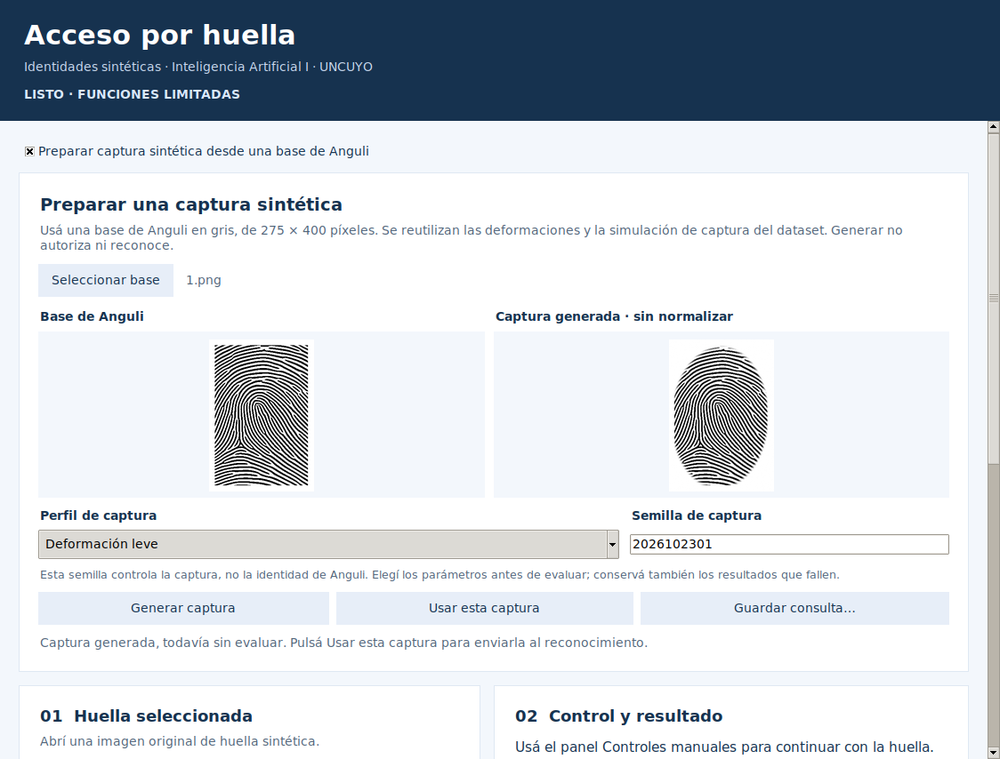
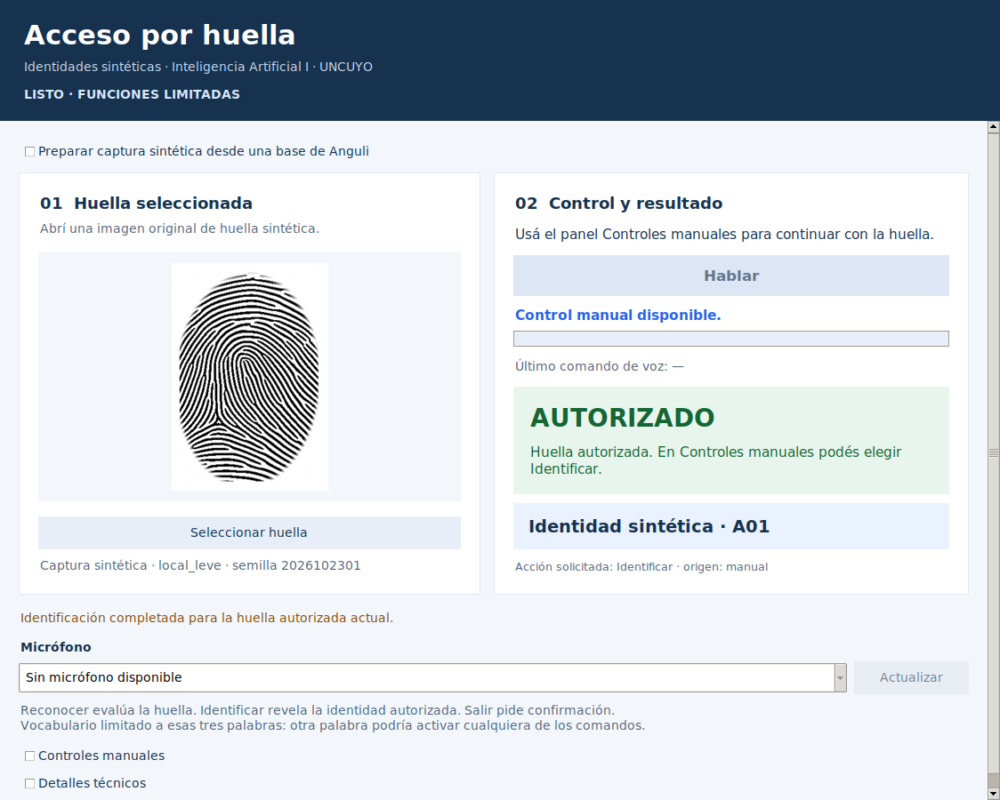

# Evidencia de preparación de capturas · 23/10/2026

Esta carpeta registra comprobaciones del asistente en Linux, sobre la ampliación incremental del ZIP inicial de interfaz. La aplicación utiliza inferencia real de huellas y el generador existente. El modelo K-NN de voz sigue disponible únicamente en la instalación Windows del autor; no se lo sustituyó por otro.

## Diagnóstico congelado

[consultas.csv](consultas.csv) contiene las 170 consultas, incluidas las rechazadas, con condición, perfil, semilla, hash de píxeles, distancia, decisión y comparación con la identidad conocida **solo del diagnóstico**. [resumen.json](resumen.json) conserva semillas prefijadas, versiones y hashes de modelo/código. Se verificó que los archivos de modelo, correspondencia y umbral no cambiaron.

Se usaron tres bases autorizadas y dos intrusas de validación. No se procesaron bases I03/I04 o imágenes reservadas para prueba. Cada captura corresponde a una consulta sintética de una base ya conocida en desarrollo; no se afirma independencia biométrica entre capturas.

| Condición | Autorizadas correctas | Intrusos rechazados | Errores técnicos |
|---|---:|---:|---:|
| Base limpia | 0/3 | 2/2 | 0 |
| Solo contacto | 0/9 | 6/6 | 0 |
| Contacto y calidad | 3/45 | 30/30 | 0 |
| Procedimiento completo | 45/45 | 30/30 | 0 |

Las diferencias respaldan usar el procedimiento completo para preparar una consulta de esta demostración. No prueban que la deformación no lineal por sí sola explique el resultado: también cambia el muestreo/interpolación y su interacción con el procesamiento posterior. No se eligieron semillas exitosas, se reajustaron centroides ni se aumentó el umbral. El reconocimiento directo de bases limpias sigue pendiente.

## Pruebas de software ejecutadas

| Grupo | Aprobadas | Registro |
|---|---:|---|
| Preparador, equivalencia y reproducción | 4 | [Salida](pruebas_preparador.txt) |
| Ventana de preparación con generador/modelo reales | 1 | [Salida](ventana_preparador.txt) |
| Regresión de contratos de interfaz | 10 | [Salida](regresion_integracion.txt) |
| Regresión de ventana anterior | 2 | [Salida](regresion_ventana.txt) |
| **Total** | **17** | Sin fallos |

Las cuatro pruebas nuevas comprueban igualdad de píxeles con `generar_conjunto.producir` en los cinco perfiles, repetición con semilla fija, conservación de la base, entradas inválidas, guardado con receta, reproducción y coincidencia de inferencia en memoria/disco. La consulta completa con semilla 2026102301 y perfil leve se comprobó con las cinco identidades de desarrollo.

El recorrido gráfico verificó que preparar no cambia la autorización de la consulta anterior, que Usar esta captura la invalida, que cambiar parámetros invalida el borrador, que cancelar selección/guardado conserva el estado y que se bloquean operaciones simultáneas. Los diálogos de archivo recibieron respuestas controladas mediante mocks; las imágenes, generación e inferencia fueron reales. La regresión de voz conserva su simulación explícita de coordinación: no representa reconocimiento acústico real.

Se comprobaron compilación de los Python nuevos/modificados, enlaces locales y `git diff --check`. No se agregaron dependencias. Los contratos se ejecutaron con Python 3.12.14; la ventana adicional usó Python 3.12.3/Tk 8.6.14 en escritorio virtual. Las versiones científicas coinciden con las fijadas por el proyecto.

## Inspección gráfica

Se revisaron vistas a 1124 píxeles y 720 píxeles de ancho, proporciones de imágenes, controles deshabilitados, mensajes y desplazamiento vertical. El desplegable se cierra al usar la captura para dejar visible el panel de acceso.

La segunda captura muestra A01, perfil leve y semilla 2026102301: distancia 3.284719866642. El audio está deshabilitado porque los recursos de voz no están en este entorno. No se presenta como una predicción de voz.

La ejecución del nuevo preparador, diálogos y escalado en Windows están pendientes. La demostración de voz anterior del autor no se confunde con una comprobación de esta ampliación. Las instrucciones exactas y los archivos/capturas solicitados están en [preparacion_capturas.md](../preparacion_capturas.md).
